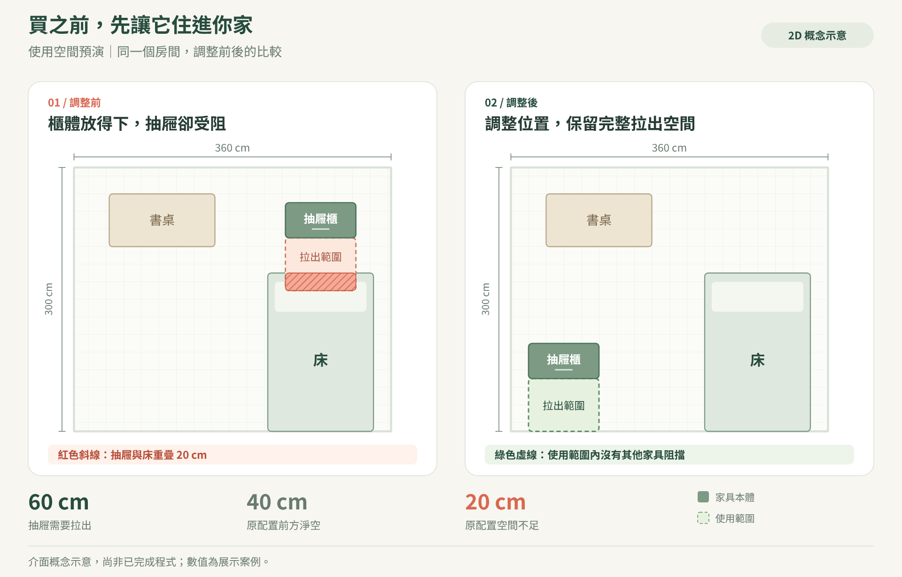
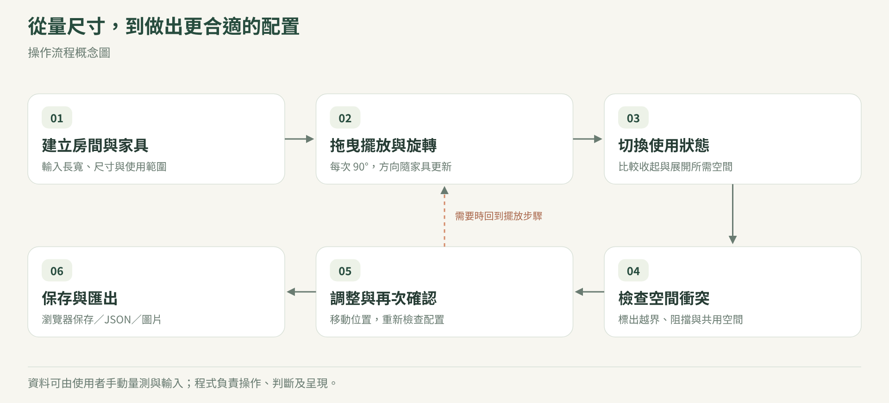
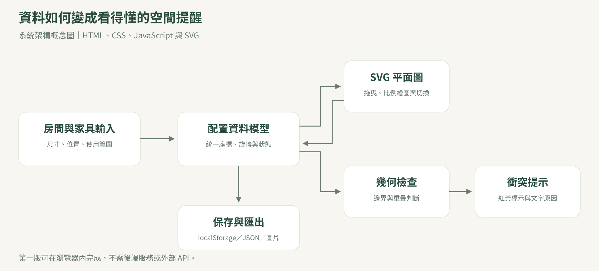

# 買之前，先讓它住進你家

**家具使用空間預演器｜期末專案發想**

讓椅子先拉開、讓抽屜先打開，再決定家具怎麼擺。

> 本頁為專案提案。現已有可操作的 2D 原型，支援拖曳、旋轉、使用範圍與衝突判斷。下方三張圖仍為概念示意。

**互動 Demo 已備妥：** [單檔版 standalone.html](standalone.html)（下載後開啟），[GitHub Pages 啟用步驟](DEPLOY.md)。

## 1. 專案動機與目標

買家具時，我們通常會先量尺寸，確認家具能不能擺進房間。但實際生活需要的空間不只家具本身：椅子需要向後拉、抽屜需要向前開，擺得下仍可能影響使用。

我想製作一個「家具使用空間預演器」，讓使用者在購買或重新擺放家具前，用簡單的 2D 房間圖預演家具使用狀態，提早發現空間衝突，減少買錯家具、退換貨與反覆搬動的麻煩。

主要使用者是租屋學生、小坪數住宅住戶，以及準備添購家具的人。專案的重點是將「家具本體」與「使用時需要的範圍」分開呈現，讓使用者看見平常容易忽略的空間需求。這是本專案的設計切入點，不宣稱市面上完全沒有類似工具。

## 2. 使用情境與預期效果

例如，使用者想在床旁邊放一個抽屜櫃。櫃體雖然放得下，但抽屜需要向前拉出 60 公分，前方到床沿只剩 40 公分。

使用者切換到「使用中」後，畫面將抽屜展開範圍與床的重疊處標成紅色，顯示「抽屜前方空間不足 20 公分」。使用者移動櫃子或調整方向後，可以立即重新檢查，找到沒有這項衝突的配置。

上述數值是展示案例；實際使用時，尺寸與需要的操作空間由使用者量測輸入，不視為通用人體工學標準。

圖 1｜調整前後的使用空間示意（概念圖，非程式截圖）

## 3. 使用流程

圖 2｜使用流程概念圖

## 4. 第一版功能與範圍

- **建立房間：**手動輸入矩形房間的長、寬，以公分為單位建立等比例俯視圖。

- **新增家具：**先支援桌子、椅子、床與抽屜櫃，提供可修改尺寸的簡單範本。

- **調整配置：**拖曳家具、修改尺寸、刪除家具，並支援每次 90 度旋轉。

- **使用狀態切換：**用不同顏色區分家具本體與椅子後拉、抽屜拉出的空間。

- **衝突檢查：**家具本體相撞、家具或使用範圍超出房間、使用範圍撞到其他家具時，顯示原因。

- **同時使用提醒：**兩個使用範圍重疊時，以黃色提醒「同時使用可能衝突」，不直接判定家具不能使用。

- **保存與分享：**在同一瀏覽器保存配置；匯出、匯入 JSON 設定檔，並匯出配置圖片。

第一版的房間與家具以矩形處理，使用範圍由家具範本搭配使用者輸入。量測尺寸、查詢商品規格與設定需求可以手動完成；程式負責畫面操作、幾何判斷與結果呈現，讓整個流程能正確走完。

## 5. 系統架構與使用技術

圖 3｜系統架構概念圖

- **HTML、CSS：**建立尺寸表單、家具清單、狀態切換與結果面板。

- **JavaScript：**處理資料更新、拖曳、旋轉、碰撞判斷及存檔。

- **SVG：**以房間實際尺寸設定座標比例，繪製家具與使用範圍。

- **localStorage、JSON：**在瀏覽器保存資料，並透過設定檔備份或分享。

- **Canvas：**將配置圖轉成可下載的 PNG 圖片。

- **Git、GitHub：**管理程式版本與開發紀錄。

每件家具記錄名稱、寬深、位置、旋轉方向，以及相對於家具的使用範圍。家具旋轉時，本體與使用方向一起更新。第一版只允許 90 度旋轉，因此可以用矩形邊界比較判斷重疊，演算法與介面都能維持可控制的規模。

檢查使用範圍時，會排除它所屬的家具本體，避免誤判；兩個區域只有邊緣相接時，不當作面積重疊，但使用者仍可以自行預留餘裕。

## 6. 可行性與驗證計畫

第一版的必要資料均能由使用者量測或查商品規格取得；幾何運算與畫面操作可在瀏覽器內完成，不需要外部 API、3D 建模或後端服務。配置建議先由使用者調整，系統提供即時檢查，不在第一版要求自動找出最佳擺法。

預計先完成「一個房間、一張床、一個抽屜櫃」的小型原型，驗證下列案例：

- **兩件家具本體重疊：**標紅並指出衝突家具。

- **抽屜需拉出 60 公分，前方僅有 40 公分：**顯示與床重疊，並在此單方向案例中指出不足 20 公分。

- **家具或使用範圍超出房間：**標示越界位置與原因。

- **兩個使用區域重疊，本體未相撞：**黃色提醒同時使用可能衝突。

- **移動或旋轉後解除衝突：**更新畫面並移除原本提示。

- **儲存後重新開啟、或匯出再匯入：**家具尺寸、位置與使用設定保持一致。

另以尺量測或等比例紙模型，核對案例中的尺寸與干涉位置，確認畫面結果符合輸入資料。目前已完成可操作的 2D 原型。幾何引擎 10 項單元測試與 11 組瀏覽器操作驗證通過；測試涵蓋拖曳、旋轉、衝突、保存、匯入匯出與手機版面。門片、非矩形房間與完整通道檢查仍屬後續延伸。

## 7. 開發順序與後續延伸

第一階段完成房間、家具資料與等比例繪圖；第二階段加入拖曳、旋轉與使用範圍；第三階段完成衝突提示、資料保存與匯出；最後使用固定案例與實際量測結果驗證，整理操作展示。

核心功能完成後，再評估門片開啟範圍、不規則房間與通行寬度檢查。門片需要以旋轉掃過的扇形處理；通道是否連通也需要額外的路徑判斷，均不把簡單的矩形重疊檢查當成已完成的替代功能。

## 8. 預期成果

期末希望呈現一個可以實際操作的網頁，讓使用者完成「建立房間 → 放入家具 → 預演使用 → 看見衝突 → 調整並保存」的完整流程。成果包含可操作原型、介面與流程圖，以及調整前後的配置比較。

系統提供的是依輸入尺寸建立的 2D 規劃參考；第一版不處理高度、家具變形與完整室內設計規範。我的目標是讓使用者在搬動或購買家具前，先看見容易忽略的使用空間問題。
